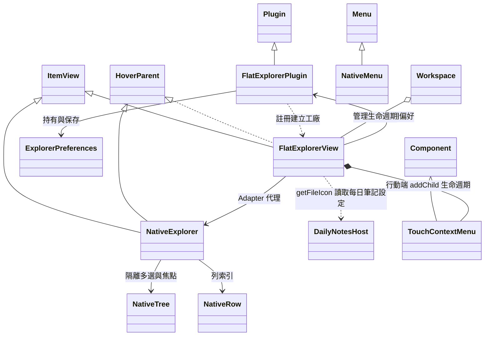
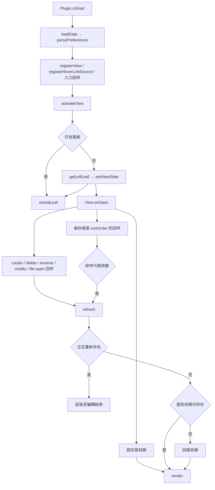
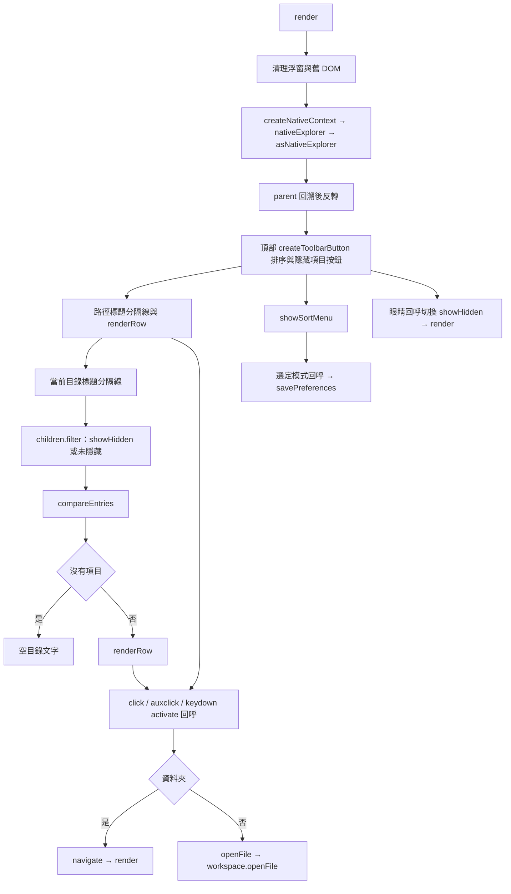
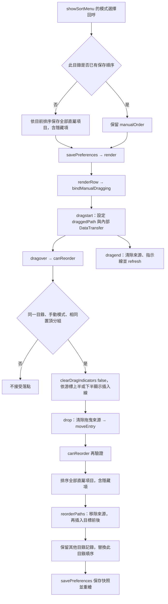
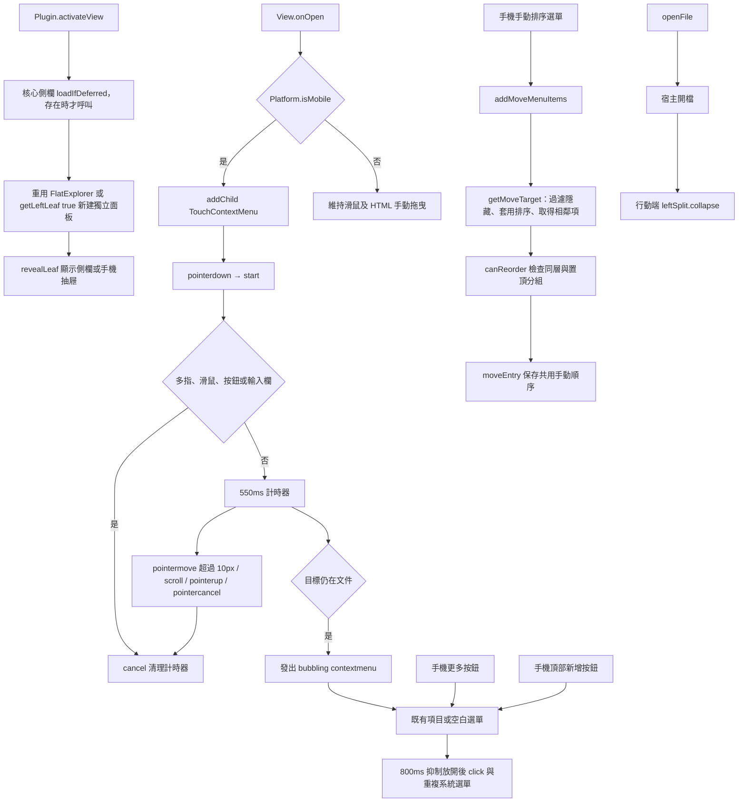
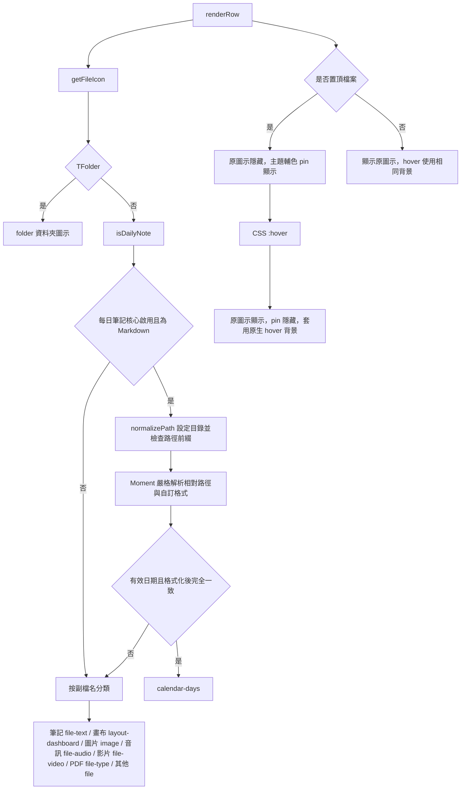
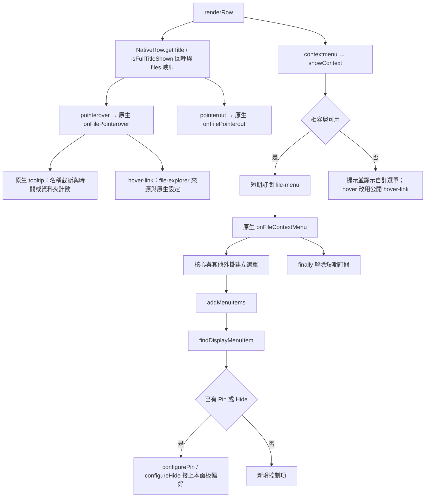
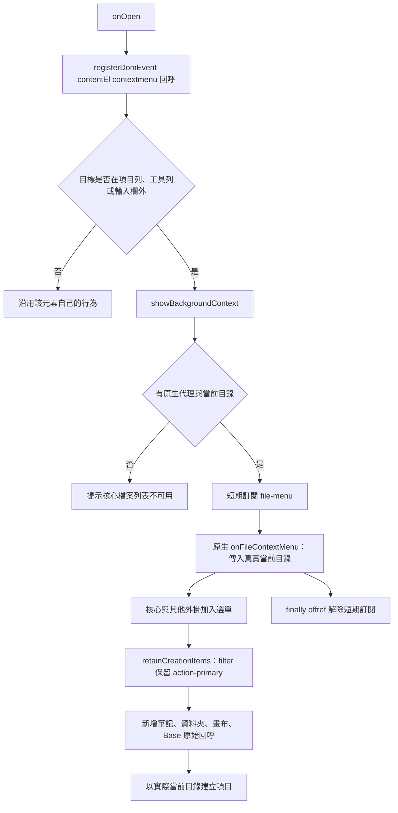
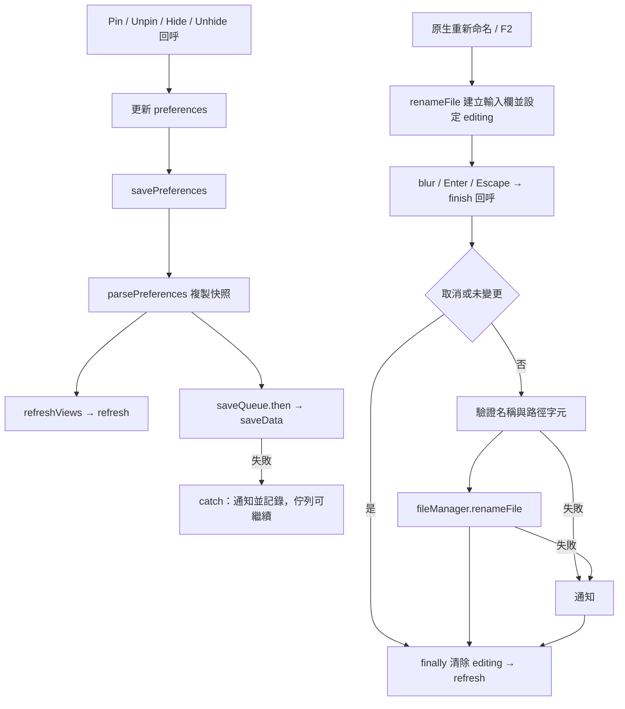

# FlatExplorer 架構

模組提供平面目錄導覽、主題原生列與頂部工具列、類型與置頂圖示、原生 hover／單項目選單橋接，以及可保存的置頂、隱藏、排序偏好。

## 類別與資料契約

| 定義 | 原始碼 | 責任 |
| --- | --- | --- |
| FlatExplorerPlugin | [src/FlatExplorerPlugin.ts](src/FlatExplorerPlugin.ts) | 註冊入口、載入偏好、序列化保存與同步路徑。 |
| FlatExplorerView | [src/FlatExplorerView.ts](src/FlatExplorerView.ts) | 平面兩區、導覽、排序、項目與空白選單、hover、就地改名。 |
| ExplorerPreferences | [src/explorer_preferences.ts](src/explorer_preferences.ts) | pinned／hidden／manualOrder 路徑陣列及 sortOrder 代碼。 |
| NativeExplorer | [src/native_explorer.ts](src/native_explorer.ts) | 核心內部檔案總管介面，繼承 ItemView、HoverParent。 |
| NativeRow | [src/native_explorer.ts](src/native_explorer.ts) | 本面板列的選單定位與 tooltip 文字資訊。 |
| NativeTree | [src/native_explorer.ts](src/native_explorer.ts) | 空多選集合及不改原生焦點的介面。 |
| NativeMenu | [src/native_explorer.ts](src/native_explorer.ts) | items 為選單項目陣列，項目的可選 titleEl 用於辨識其他外掛的同名 Pin／Hide。 |
| DailyNotesHost | [src/file_icons.ts](src/file_icons.ts) | 將每日筆記核心設定的讀取限定在圖示分類邊界，缺少該 API 時視為一般筆記。 |
| TouchContextMenu | [src/TouchContextMenu.ts](src/TouchContextMenu.ts) | 管理行動端長按、捲動取消及點擊／選單去重，不控制檔案操作。 |

原生相容層是 Adapter：代理繼承現有檔案總管，只覆寫本面板所需的 DOM 映射、多選、重新命名與建立後處理。原生核心 view 與其樹狀狀態不被改寫。選單及 hover 行為依賴內部 API，已確認 Obsidian 1.14.5；其他版本須驗證。沒有聲稱支援多選或樹狀拖放。

## 啟動與事件同步

Plugin.onload 的 rename／delete 回呼使用 remapPaths 更新 pinned、hidden 與 manualOrder，再呼叫 savePreferences。祖先改名會同步後代；刪除清理偏好。View.onClose 清理浮窗與拖曳來源，registerEvent／registerInterval 由宿主清理訂閱與計時器。refresh 在編輯或拖曳期間延後重繪，避免移除來源 DOM。activateView 無可用側欄即返回；宿主載入錯誤向外傳遞。

## 平面顯示與排序

compareEntries 先比較 pinned。manual 模式接著比較 manualOrder 路徑索引，允許資料夾與檔案混排；沒有保存索引的項目排在已保存項目之後，再使用原有資料夾優先及自然名稱序。其他模式維持資料夾優先，檔案與置頂群組套用六種名稱／時間排序；時間相同以名稱穩定排序。sortOrder 在 native 模式讀取核心 view 的代碼，否則讀偏好。render 的 filter／sort 回呼僅處理直屬項目。路徑區不受隱藏列表影響，確保能返回。

## 手動排序

manualOrder 為全 Vault 的唯一完整路徑序列；每次比較僅取目前目錄的項目，因此各目錄相對順序獨立。parsePreferences 的 paths 回呼驗證與去重 manualOrder，舊版無此欄位時使用空陣列。showSortMenu 僅在此目錄尚未保存任何順序時初始化，避免切回手動模式覆蓋歷史。

bindManualDragging 只綁定當前目錄列，路徑區不綁定。dragstart 保存面板內的來源並使用 application/x-flat-explorer-order，不提供宿主搬移檔案的格式；dragover 清除舊插入線但保留來源半透明外觀；dragleave 在真正離開列後清除該列指示；drop 重驗來源與目標後保存；dragend 支援取消並補做延後的重繪。canReorder 拒絕外來路徑、不同目錄、自己、非手動模式、編輯中及跨置頂分組。moveEntry 以完整 children 保存順序，包含隱藏項目；reorderPaths 不修改輸入陣列，無效來源或目標則回傳不變的副本。clearDragIndicators(clearSource=true) 控制是否一併移除來源外觀。不呼叫 Vault 的搬移或寫入檔案 API。

renderRow 的 activate 回呼區分資料夾及檔案，支援 Enter／Space、Ctrl／Cmd 與滑鼠中鍵新分頁；F2 啟動改名。列使用 nav-file／nav-folder 原生類別，標題以 ellipsis 截斷。Markdown 隱藏副檔名，其他檔案保留；資料夾無斜線，所有列沒有樹狀深度。getViewType、getDisplayText、getIcon 提供宿主中繼資料。

createToolbarButton 建立原生同款 div.clickable-icon.nav-action-button，補上 role、tabindex 與 Enter／Space 觸發 click 的回呼。排序使用原生 sort-asc 圖示。根 view-content 以限定 data-type 的 CSS 覆寫主題預設內距為 0，避免外層 12px 留白將工具列下推。工具列不捲動，兩個區段位於獨立 nav-files-container。標題以 ::after 產生同行分隔線，文字使用 --text-muted。

## 行動端與觸控

TouchContextMenu.constructor 註冊 root 與 root.doc 的事件；pointermove 回呼只處理同一觸點，scroll 採 capture，pointerup／pointercancel 取消尚未完成的長按。start 排除非主要 touch／pen 及 input／textarea／clickable-icon；計時回呼確認 isConnected，以 dispatching 區分自行送出的 contextmenu。click capture 阻止長按釋放造成導航；contextmenu capture 取消計時，並去除長按後的原生重複事件。cancel 清除 timer／target／pointerId；onunload 再清理計時器，Component 解除註冊事件。render 及 onClose 會取消未完成的手勢，避免舊 DOM 操作。

renderRow 在手機加入可鍵盤操作的更多按鈕，click 回呼停止冒泡；createToolbarButton 的 Enter／Space 也停止冒泡，避免同時導航。觸控 pointerover 不觸發桌面預覽；手機不註冊 HTML 拖曳。addMoveMenuItems 產生上移／下移項目，getMoveTarget 只接受直屬且同置頂分組的可見鄰項，沒有可用位置時禁用；操作時再次計算位置。hide／pin／manualOrder 與桌面共用，不另建資料格式。

行動 CSS 將項目、工具列與更多按鈕的觸控範圍設為至少 44px，允許垂直 pan，停用文字長按選取；rename input 保留文字選取。手機原生 nav-header 預設置底，因此明確指定工具列 order=0、內容 order=1。置頂圖示不受觸控產生的黏著 hover 影響；桌面在 hover 媒體條件下沿用切換。執行來源僅匯入 obsidian，不使用 Node.js／Electron；manifest 的 isDesktopOnly=false。

## 類型圖示與置頂 hover

file_icons.ts 的 getFileIcon 與 isDailyNote 為純讀取分類函式。每日筆記讀取 DailyNotesHost.internalPlugins.getPluginById；enabled=false 或缺少 API 時不猜測日期檔案。目錄尾斜線由 normalizePath 處理；日期格式預設 YYYY-MM-DD，可包含子目錄。所有列都有固定寬度的 flat-explorer-icons 欄位，內含 flat-explorer-type-icon；置頂檔案額外含同一 grid 位置的 flat-explorer-pin，CSS visibility 切換不造成文字移位。資料夾直接使用資料夾圖示，不再顯示箭頭；圖示皆由 Obsidian setIcon 提供。

列的圖示與文字 gap 使用 calc(var(--size-4-1) + 2px)。大頭針採 hsl(var(--accent-h), var(--accent-s), var(--accent-l))，與參考的 File Explorer Plus Pin 圖示使用相同輔色來源；區段標題仍採 --text-muted，兩者語意不同。

## 原生 hover 與選單

asNativeExplorer 驗證三個必要原生處理器。createNativeContext 使用 Object.create 借用處理器；files 為 WeakMap、fileItems 為路徑到 NativeRow 的索引，tree 的 selectedDoms 為空集合、setFocusedItem 為空回呼。hoverPopover 歸該代理所有，重繪時卸載。afterCreate 回呼開啟新檔案，或回到新資料夾的父層後啟動改名；startRenameFile 改接本面板。

showContext 的臨時 file-menu 回呼只接受同一目標檔案；try/finally 保證解除訂閱。findDisplayMenuItem 只辨識 Pin／Unpin、Pin File／Unpin File、Pin Folder／Unpin Folder、Hide／Hide File／Hide Folder 等確切標題，在這次選單中替換對應回呼，防止 File Explorer Plus 產生重複項目；其他項目保留。Pin 與 Hide 均用於檔案與資料夾，根目錄不提供顯示控制。資料夾在置頂群組中仍適用一般排序或手動排序，圖示切換共用原有 CSS。

## 空白區原生新增選單

retainCreationItems 位於 native_explorer.ts，透過 NativeMenu.items 的 section 判斷分區，filter 回呼移除其他分區及分隔線的 DOM；保留項目的原生文字、圖示及回呼。直接傳入真實 TFolder，避免模擬根目錄導致新資料夾或畫布建立到錯誤位置。空白區不追加本套件的 Pin／Hide。項目列的 contextmenu 本來就停止冒泡，因此不會同時開啟兩個選單。核心畫布或 Bases 未啟用時，選單依原生實際提供的項目呈現。

## 儲存與重新命名

parsePreferences 的 paths 回呼只保留唯一字串，無效排序回 native。remapPaths 的 flatMap 回呼比對完整路徑或「舊路徑/」後代，避免誤判同名前綴。renameFile 的 row find 回呼按 data-path 找列；input click 防冒泡，finish 防止 blur 與 Enter 重複提交，Escape 不寫入。重新命名交由 FileManager 更新連結，失敗顯示通知。openFile 透過 Workspace 開啟，失敗顯示通知並記錄。

## 工具與測試

[esbuild.config.mjs](esbuild.config.mjs) 頂層選擇單次 build 或 context.watch，無自訂函式；產出 CommonJS main.js，obsidian 保留為宿主依賴。

[tests/explorer_preferences.test.mjs](tests/explorer_preferences.test.mjs) 使用 esbuild 記憶體產出及 vm 載入純偏好模組；require 回呼只注入 instanceof 所需的 TFile／TFolder 替身。file 函式建立含 path、name、basename、stat.mtime／ctime 的檔案替身。八個 test 回呼驗證置頂及取消、六種排序的兩個優先群組、改名刪除後代邊界、無效設定、手動混排與新項目、前後拖放及不變性、模式切換與跨目錄保存、資料夾置頂與筆記混排；sort／map 回呼比較實際輸出順序。

[tests/file_icons.test.mjs](tests/file_icons.test.mjs) 以相同載入策略測試圖示分類；normalizePath 替身僅處理測試需要的尾斜線。file 函式建立含 path／name／basename／extension 的替身，dailyHost 建立 enabled／folder／format 設定替身。三個 test 回呼驗證類型區分、有效日期與精確目錄邊界、日期子目錄及 Vault 根目錄；Moment 使用實際日期解析實作。

本機 .qa 為忽略版本控制的實機驗證暫存區。0.2.0 已通過 15 項 Obsidian 1.14.5 檢查：核心與第三方選單保留、不重複顯示控制、置頂順序及圖示、設定保存、Hide／Unhide、原生 hover-link、改名啟動與 Escape 取消、資料夾無斜線。測試前後還原偏好，不改名或刪除使用者筆記。實際視覺已由原生面板與選單截圖檢查；行動版與舊版本尚未實測。

0.3.0 重新通過上述 15 項檢查及七個單元案例。實機測量原生與本套件按鈕均為 28 × 24 CSS px、內距 4px 6px、圖示 16px，工具列頂端與內容頂端相同。離屏 DOM 另確認筆記／每日筆記／畫布圖示，並以 CDP 強制 :hover 驗證 pin 隱藏、原圖示顯示及非透明的主題背景。驗證後移除臨時 DOM。

0.4.0 通過十個單元案例與十六項手動排序實機檢查：選單模式、初次順序、draggable 範圍、插入線與來源外觀、拖放事件、磁碟保存、跨目錄保留、實體路徑不變、模式切換、隱藏項保留、置頂邊界與拒絕外部來源。面板已截圖檢查，插入線由實際計算樣式確認為主題色的 2px inset shadow；測試前後還原偏好與導覽狀態。

0.5.0 通過十一個單元案例與十二項空白選單／資料夾置頂實機檢查：空白選單與分區、四種原生建立回呼的當前目錄參數、根目錄選單、資料夾 Pin／Unpin、磁碟保存、圖示及排序位置與不重複控制。新增回呼由測試攔截並立即還原，不建立實體測試檔案。選單項目由實際 DOM 確認，測試後還原偏好與目錄。

0.6.0 通過十一個單元案例、十八項官方行動模擬檢查，以及桌面十二項新增／資料夾置頂與十六項手動排序回歸。行動檢查涵蓋長按、移動與捲動取消、誤點／選單去重、更多及新增入口、44px 點擊區域、不依賴 HTML 拖曳的上移保存、側欄收合及展開後實際可見。390 × 844 viewport 無水平溢出，工具列幾何位置在內容上方。側欄開關驗證等待原生動畫完成。依官方行動開發文件使用 app.emulateMobile，測試前保存編輯與版面，結束後還原桌面模式與工作區。Android／iOS 實機尚未驗證。

## 設定檔欄位

| 檔案 | 契約 |
| --- | --- |
| package.json | name／version／description 識別套件；author 為 MiuDog；repository.type／url 指向 GitHub Git 儲存庫；private 防止 npm 意外發佈；main 指定產物；type 指定工具 ESM；scripts.dev 監看、build 型別檢查與建置、test 執行 Node 測試；devDependencies 為 esbuild／obsidian／typescript。 |
| manifest.json | id 安裝目錄與識別；name 顯示名稱；version 發行版；minAppVersion 為套件最低目標，完整內部 API 僅確認 1.14.5；description 用途；author 為 MiuDog，authorUrl 為作者 GitHub；isDesktopOnly=false 支援行動載入，已模擬驗證，實機待驗證。 |
| versions.json | 版本字串為鍵，最低 Obsidian 版本為值；0.6.0 對應 1.5.0，與 manifest 契約一致。 |
| tsconfig.json | compilerOptions.target／module／moduleResolution 編譯環境；lib ES／DOM 型別；strict／noImplicitReturns／noUncheckedIndexedAccess 檢查；isolatedModules 配合 esbuild；skipLibCheck 跳過依賴；include 限定 src。 |
| esbuild options | entryPoints 入口；bundle 合併；external 排除宿主；format／target 產物格式；outfile 檔名；sourcemap 開發啟用。 |

data.json 使用 ExplorerPreferences 契約；package-lock.json 為 npm 依賴快照；dist 是可安裝三檔資料夾與 ZIP。自行維護的程式碼使用 Tab 縮排，由 .editorconfig 設定顯示寬度 2。

## GitHub 發布

公開儲存庫為 MiuDog/FlatExplorer，Release 標籤與 manifest.version 一致，使用 0.6.0。發行附件為 main.js、manifest.json、styles.css 與含 flat-explorer 資料夾的 flat-explorer.zip。main.js／dist／node_modules／.qa 由 .gitignore 排除，不將本機測試資料、Vault 偏好、截圖或依賴套件提交到原始碼儲存庫。

## 行動裝置下載文件與發行附件

[安裝入口](docs/install/README.md) 連結 [Android](docs/install/android.md)、[iPadOS](docs/install/ipados.md)、[iOS](docs/install/ios.md)、[Sync](docs/install/sync.md) 與 [更新復原](docs/install/updates.md) 文件。這些是安裝文件，沒有新增執行期類別或函式。

目前推薦 BRAT：公開 Release 已提供其所需的三個單獨資產，manifest.isDesktopOnly=false。BRAT 可接受 MiuDog/FlatExplorer 或完整 GitHub 儲存庫 URL。平台 ZIP 為 flat-explorer-android.zip、flat-explorer-ipados.zip、flat-explorer-ios.zip，各自包含同一個 flat-explorer/ 三檔資料夾，另於 ZIP 根目錄附 install-android.md、install-ipados.md 或 install-ios.md。三份指南也作為 Release 獨立附件，與現有 0.6.0 發行版並存，不變更已發布標籤與主程式。

平台文件依 BRAT、Obsidian 官方文件於 2026-11-02 查證；下載資產驗證格式與雜湊，不宣稱 Android／iPadOS／iOS 實機安裝已測試。指南中 iOS／iPadOS 以 BRAT 為主、電腦同步為備用，不假設系統「檔案」App 可直接操作 Vault 的隱藏資料夾。
